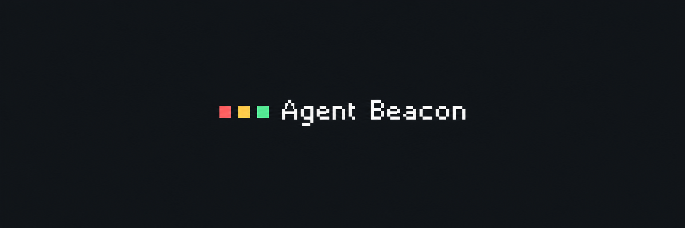

# Agent Beacon

**English** · [Українська](README.uk.md)

**Know when your AI agents need you.** A local Windows tray indicator, Android notifications and customizable widgets for Codex and Claude Code, with experimental Antigravity support.

[**Download and start — Windows EXE**](https://github.com/Karaoki15/agent-beacon/releases/download/v0.2.0-beta.3/AgentBeacon-Setup.exe)

Start with Windows: the installer opens a step-by-step browser wizard. **The Android APK is included in the package** — download it to your phone from that wizard.

Windows **0.2.0-beta.3** · Android **0.1.14** · [Release files and checksums](https://github.com/Karaoki15/agent-beacon/releases/tag/v0.2.0-beta.3)

## Install in a few steps

You **do not need Git, Python, GitHub Desktop or a GitHub account** to download and use the release.

1. **Install on your PC.** Download the EXE above → run it → **Встановити й відкрити** (*Install and open*). A local browser wizard opens on your computer. The Windows setup UI is currently Ukrainian.
2. **Connect your agents.** Select Codex, Claude Code or experimental Antigravity. For Android, also enable **Підключати телефон у домашній Wi-Fi мережі** (*Connect a phone on your home Wi-Fi*) → **Переглянути зміни** (*Review changes*) → **Підключити вибраних агентів** (*Connect selected agents*). Beacon backs up existing settings before adding hooks.
3. **Check a real signal.** Restart the selected agent or open a new local chat, send a short task, then click **Перевірити підключення** (*Check connection*) in the wizard. Installed hooks and received events are shown separately.
4. **Install Android from the wizard.** In **Телефон — один раз** (*Phone — one-time setup*), click **1 · QR для встановлення APK** (*APK installation QR*). Scan it with your phone's ordinary camera, download and install the APK. Keep the phone and PC on the same trusted network; Android may ask for permission to install the file.
5. **Pair your phone with the PC.** In the wizard, click **2 · QR підключення** (*Pairing QR*). Open Agent Beacon on Android and use its pairing scanner. Allow notifications and enable background monitoring if you want background notifications and widget updates.

You can close the browser tab after setup — **Beacon must keep running in the Windows tray**. If your phone cannot reach the PC, expand **Телефон не бачить комп’ютер?** (*Phone cannot see the computer?*) for help and the separate private-network firewall permission.

Separate APK for updates or a fallback download

[Download the Android APK from GitHub](https://github.com/Karaoki15/agent-beacon/releases/download/v0.2.0-beta.3/AgentBeacon-Android.apk). For first-time setup, start with the Windows wizard above.

[**Full installation guide →**](docs/INSTALL_EN.md) · [Troubleshooting and updates](docs/INSTALL_EN.md#when-something-does-not-connect)

## What you see

| Indicator | Meaning |
| --- | --- |
| 🔴 Working | An enrolled agent is working. |
| 🟡 Needs you | Your answer is needed, or a valid question reminder is still active. |
| 🟢 Ready | Ready for another request. This does not evaluate whether the result is correct. |
| ⚪ No update | No confirmed fresh signal is available. |

- Windows tray status and a local browser dashboard with chat and project names.
- Android alerts for questions and completed requests. Starts and routine updates stay silent.
- A compact widget and an agent overview widget. Each large widget has its own agents, row order and optional chat counts.
- Automatic reconnection, a battery saver and connection diagnostics.
- **Ukrainian / English** Android UI. Automatic mode uses English only for an English phone; every other phone language falls back to Ukrainian. You can override it in the app. Short widget labels stay English.

*Layout illustration generated from the Android layouts; not a screenshot of a physical phone. Widget spacing also depends on the launcher.*

## Supported agents and privacy

| Agent | Support in this beta |
| --- | --- |
| Codex | Enrolled local sessions through the supported hook/observer integration. |
| Claude Code | Local Code sessions with Beacon hooks enabled. |
| Antigravity | Experimental hook adapter; live application validation remains open. |

Ordinary **Claude Chat**, cloud sessions, SSH/WSL sessions and iPhone are not covered by this beta. Installing Beacon does not sign you into an agent or change its tool permissions.

The phone receives status and chat/project metadata, rather than prompt or response bodies. Beacon uses your computer and trusted local network; it does not require a hosted Beacon account or cloud relay. Pairing QR codes are single-use and expire after two minutes. Do not publish them.

## Beta status

The EXE is currently **unsigned**, and the APK uses a **debug development certificate**. Windows or Android can display a security notice. Verify the source and the release checksums; do not disable system protection to run an untrusted file.

Builds, payload integrity, actual bundled EXE/helper/tray behavior and automated checks are verified. Clean-machine installation, native installer/UAC/shortcuts and physical Android/LockStar acceptance remain manual checks. This is a beta preview, not a claim that every device has been tested.

[Development and building](docs/DEVELOPMENT.md) · [Protocol](docs/PROTOCOL.md) · [Antigravity setup](docs/ANTIGRAVITY.md) · [MIT license](LICENSE)
